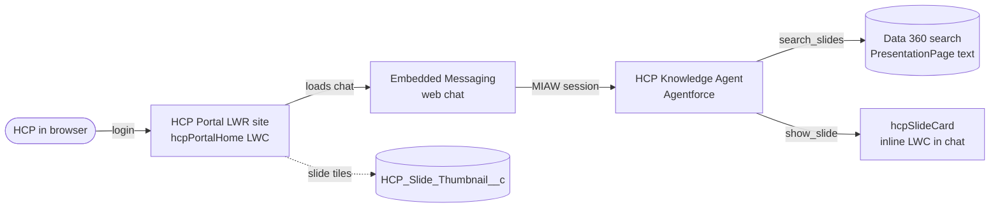

# HCP Portal with an Agentforce knowledge agent

An HCP (healthcare professional) logs in to the **HCP Portal** Experience Cloud site, asks Immunexis questions in an Agentforce chat,
and gets an answer taken from the slide text. When the HCP says yes, the agent shows the slide as an inline LWC card in the chat
(`hcpSlideCard`). It is the `Content_Search_AgentForce` pattern moved to a portal for external users.

- Org: `YOUR_ORG_ALIAS` (`YOUR_ADMIN_USERNAME`), API version 68.0
- Primary site (LWR): `https://YOUR_MYDOMAIN.my.site.com/hcpportalvforcesite/`
- Test portal user: a user on the HCP User profile with permission set `HCP_Portal_Access`. Credentials are not stored in this repo.

## Before this will work: replace the placeholders

All org-specific identifiers were removed before publishing. Search the repo for `YOUR_` and `INSTRUCTION_ID_` and fill in values from your own org.
Do not commit the real values back to a shared repo.

| Placeholder | Where | What to put there |
|---|---|---|
| `YOUR_ORG_ALIAS` | README / docs commands, `SF_ORG` for `run_agent_tests.py` | Your `sf` CLI org alias (`sf org login web -a <alias>`) |
| `YOUR_ADMIN_USERNAME` | README | Your org admin username (documentation only) |
| `YOUR_MYDOMAIN` | `staticresources/hcpChatInit.js`, docs | Your My Domain / site host prefix, so `https://<prefix>.my.site.com` and `https://<prefix>.my.salesforce-scrt.com` |
| `YOUR_ORG_ID` | `staticresources/hcpChatInit.js` | 15 or 18 character org Id (Setup > Company Information) |
| `YOUR_ESW_SITE_PATH`, `YOUR_ESW_SITE_NAME` | `staticresources/hcpChatInit.js`, docs | Site path and name generated when you create the Embedded Messaging web deployment (`HCP_Portal_Agent`), see step 6 in [docs/SETUP_AND_OPERATIONS.md](docs/SETUP_AND_OPERATIONS.md) |
| `YOUR_NETWORK_ID`, `YOUR_AURA_NETWORK_ID` | publish commands | Experience Cloud site (Network) Id, from `SELECT Id FROM Network WHERE Name = 'HCP Portal'` |
| `YOUR_AGENT_USER@example.com` | `aiAgents/HCP_Knowledge_Agent.aiAgentDefinition-meta.xml`, `aiAuthoringBundles/.../HCP_Knowledge_Agent.agent` | Username of the Einstein Agent user in your org (docs step 3 lists the permission sets it needs) |
| `YOUR_QUEUE_ID` | `flows/HCP_Portal_Route_to_Agent.flow-meta.xml` | Id of the queue or omni-channel fallback the flow routes to, or the Id of your agent routing target |
| `YOUR_AGENT_GRAPH_ID`, `INSTRUCTION_ID_1` to `_4` | `aiAgentDefinitionVersions/HCP_Knowledge_Agent#1/...` | Generated by the platform. Do not hand-fill: delete `aiAgentDefinitionVersions/` and `aiAgents/` from the deploy, then run `sf agent validate authoring-bundle` and `sf agent publish authoring-bundle --api-name HCP_Knowledge_Agent` to regenerate them from the `.agent` file |

Rough order in a new org: authenticate the CLI, fill in the placeholders above, follow the deploy order in
[docs/SETUP_AND_OPERATIONS.md](docs/SETUP_AND_OPERATIONS.md), create the Embedded Messaging deployment and copy its generated values into
`hcpChatInit.js`, redeploy that static resource, then publish the site. Re-create the test portal user and assign `HCP_Portal_Access`.

## What is in the repo

| Piece | Where |
|---|---|
| Portal home page (hero, nav, tiles) | `lwc/hcpPortalHome`, images in `staticresources/hcp_*.jpg` |
| Chat loader | `staticresources/hcpChatInit.js` (CSP forbids inline scripts, see architecture doc) |
| Tile data | `classes/HcpPortalController` reads `objects/HCP_Slide_Thumbnail__c` |
| Service agent | `aiAuthoringBundles/HCP_Knowledge_Agent` (actions `ContentSearchAction`, `HcpShowSlideAction`) |
| Inline card | `lwc/hcpSlideCard`, `lightningTypes/hcpSlideCLT` (`enhancedWebChat` renderer) |
| Chat plumbing | `messagingChannels/HCP_Portal_Messaging`, `flows/HCP_Portal_Route_to_Agent` |
| Site | `digitalExperiences/site/HCP_Portal1`, `digitalExperienceConfigs/HCP_Portal1` (the scratch copy used for deploys is not in this repo) |
| Permissions | `permissionsets/HCP_Knowledge_Agent_Access` (agent user), `permissionsets/HCP_Portal_Access` (portal users) |
| Thumbnail links | `scripts/apex/publishImmunexisThumbnails.apex` (admin, re-runnable) |
| Agent tests | `run_agent_tests.py` (`SF_ORG=YOUR_ORG_ALIAS python3 run_agent_tests.py`, writes `agent_test_results.md`) |

## Documents

- [docs/ARCHITECTURE.md](docs/ARCHITECTURE.md): components, sequence of a chat turn, data and permissions, with diagrams.
- [docs/SETUP_AND_OPERATIONS.md](docs/SETUP_AND_OPERATIONS.md): deploy order, publish steps, gotchas, security notes, open items.

## Quick operations

- Slides changed: run `sf apex run -o YOUR_ORG_ALIAS -f scripts/apex/publishImmunexisThumbnails.apex`.
- New portal user: HCP User profile, permission set `HCP_Portal_Access`, and the profile must be a member of the site.
- After changing the LWC or site: deploy, then `sf api request rest -o YOUR_ORG_ALIAS -X POST /services/data/v68.0/connect/communities/YOUR_NETWORK_ID/publish --body '{}'`.
