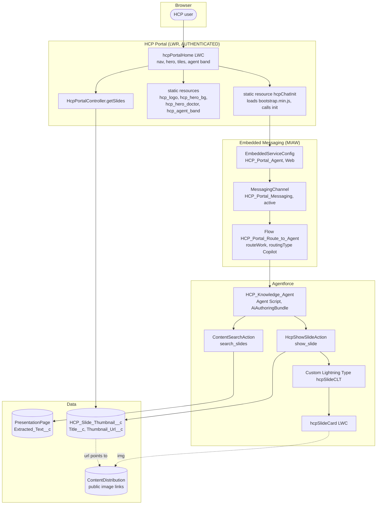
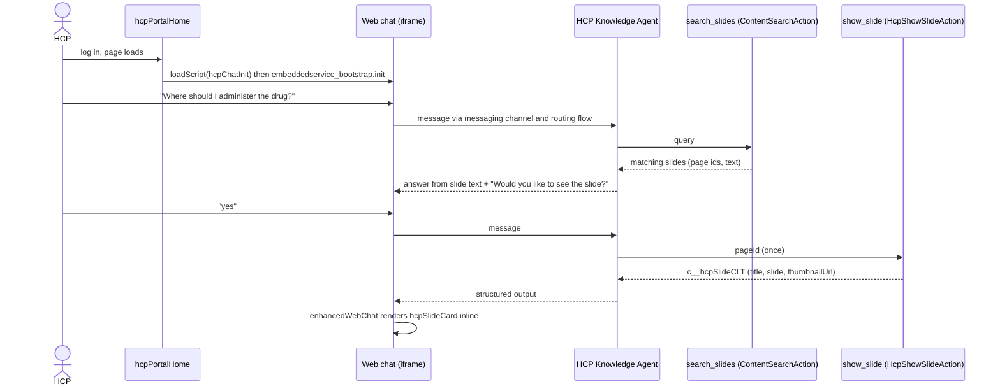
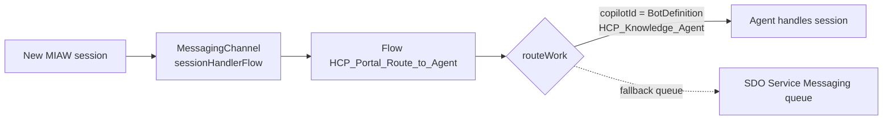
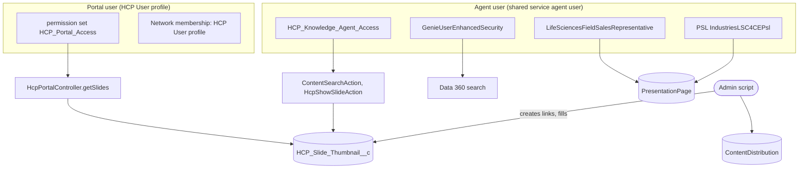
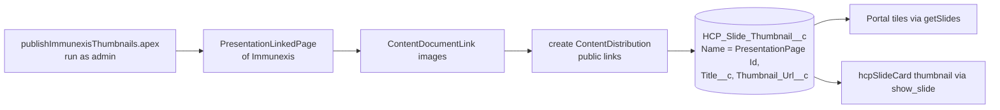
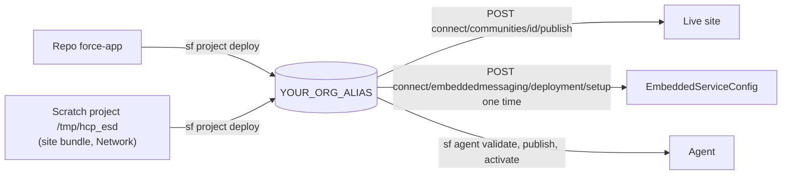

# Architecture

## 1. Components

## 2. One chat turn

The "ask, then yes" pattern: the first message only searches and answers from slide text, then asks before showing a slide.

## 3. Routing from the chat to the agent

## 4. Who runs what (permissions)

The key design constraint: Apex actions run as the **agent user**, not as the portal user.

Why the thumbnail setting exists: the agent user cannot insert `ContentDistribution`, sees its rows with blank fields and cannot read
`ContentVersion`. Portal users cannot read `PresentationPage` or `ContentDistribution` either. So an admin script creates the public links
once and copies title + URL into the `HCP_Slide_Thumbnail__c` list custom setting, which both the agent action and the portal controller read.

## 5. Thumbnail data flow

## 6. Why the chat loads through a static resource

The LWR site sends a Content Security Policy with `script-src 'self'` plus hashes, so the standard inline snippet
(`function initEmbeddedMessaging(){...}`) in head markup is blocked and the chat never starts. `hcpChatInit.js` is served from the site's own
origin, so it is allowed. It creates the `bootstrap.min.js` script tag from the deployment's site URL and calls
`embeddedservice_bootstrap.init(orgId, 'HCP_Portal_Agent', siteUrl, { scrt2URL })`. `hcpPortalHome` loads it with `loadScript` in `renderedCallback`.

## 7. Deployment topology

The site bundle (`DigitalExperienceBundle`) and the `Network` live in a scratch project outside this repo; retrieve them again with
`sf project retrieve start -m "DigitalExperienceBundle:site/HCP_Portal1" -m "DigitalExperienceConfig:HCP_Portal1" -m "Network:HCP Portal"` if needed.
